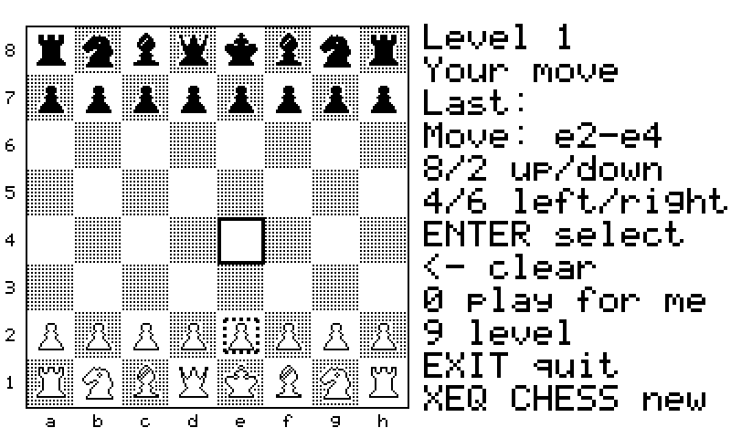
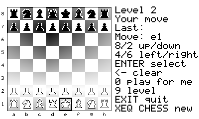

# RPN Chess42

A chess program for the **SwissMicros DM42**, written in HP-42S RPN. It draws the full board on the DM42's 400×240 screen (GrMod 3) and you move pieces with a cursor.



### Demo



*Recorded in the project's simulator at the DM42's native 400×240 resolution, with the program playing Black at level 2. White, the "human", opens with the Queen's Gambit (1.d4 d5 2.c4); the program accepts with 2...dxc4, and from move 3 White's moves come from Stockfish. All moves are entered with the cursor keys. Game: 1.d4 d5 2.c4 dxc4 3.Nf3 f5 4.e3 b5 5.a4 c6 6.axb5 cxb5 7.b3 Be6 8.bxc4 bxc4 9.Ng5 Qd5 10.Nc3 Qd6 11.Nb5 Qb4+ 12.Bd2 Qxb5 13.Nxe6 Qd5 14.Nc7+ Kf7 15.Nxd5 e6 16.Nc7 c3 17.Bxc3 Bb4 18.Bxb4 a5 19.Qb3 a4 20.Qxe6#*

It needs a DM42 because of the GrMod graphics mode, so it won't run on an original HP-42S or on Free42.

## Requirements

- About 37 KB of free memory: roughly 16 KB of program and 1,224 registers.
- Uses registers R00–R1223 (SIZE 1224, set automatically) and flags 01–03 and 05–07, so save anything you need there first.

## Installation

1. Connect the DM42 by USB and copy [`CHESS.raw`](CHESS.raw) to its disk.
2. Load it with SETUP (Shift + 0) → File → Load Program → `CHESS.raw`.
3. Start a game with **XEQ "CHESS"**.

The file contains two programs:

- **CHESS** starts a new game.
- **CHCON** continues the current game.

## Controls

| Key | Action |
|---|---|
| 8 / 2 | cursor up / down |
| 4 / 6 | cursor left / right |
| ENTER | select piece, then select destination |
| ← | cancel selection |
| 0 | calculator moves now (press at the start to play Black) |
| 9 | change level (1–3) |
| EXIT | quit (XEQ "CHCON" to continue) |

## Playing

- Move the cursor (thick frame) to your piece and press ENTER. The piece gets a dotted frame.
- Move the cursor to the target square and press ENTER again, and the calculator replies.
- Corner marks show the last move.
- The panel shows the level, status (your move / thinking / check / mate / stalemate), the last move and your move as you build it.
- To castle, move the king two squares.
- En passant is supported.
- Promotion is always to a queen.

## Levels

- **1:** fast, a few seconds per move.
- **2:** default, stronger, slower.
- **3:** slow.

Thinking time is longer on battery than on USB power.

## Notes

- Don't press EXIT while it's thinking. That stops the program mid-search and scrambles the position, so you'd have to start a new game.
- There's no draw by repetition or 50-move rule.
- It plays sensibly and punishes blunders, but it's not a strong engine.

## How it works

### Search depth

The level is the number of half-moves (plies) searched in full:

| Level | Every move searched | Captures afterwards | Deepest line |
|---|---|---|---|
| 1 | 1 half-move | up to 4 more | 5 |
| 2 | 2 half-moves | up to 4 more | 6 |
| 3 | 3 half-moves | up to 4 more | 7 |

After the full-width part, a quiescence search follows only captures and queen promotions for up to 4 more half-moves, so the engine doesn't think it has won a piece that will simply be taken back. At any point in that phase a side may choose not to capture and take the position as it stands. Two shortcuts keep it fast:

- Captures that can't possibly bring the score up to the best result already found are skipped.
- Captures where a more valuable piece takes a less valuable one on a defended square (such as a queen taking a protected pawn) are skipped.

### Alpha-beta

The search is alpha-beta minimax in negamax form. The HP-42S can't comfortably run deep recursive subroutines, so the search runs as a loop that keeps its own record of each level in registers R220–R355.

Captures are searched first, ordered by "most valuable victim, least valuable attacker", then quiet moves. There's no iterative deepening, transposition table or killer moves.

### Other details

- **Legality:** moves are generated without first checking for check. A move that leaves its own king in check is caught one half-move later, when the opponent could capture the king, and it's rejected.
- **Mates:** it prefers a faster mate when winning and tries to delay being mated.
- **Evaluation:** material (pawn 100, knight 300, bishop 320, rook 500, queen 900), plus small bonuses for knights, bishops and the queen near the centre, bonuses for advanced pawns, and a preference for keeping the king near the edge (sensible in the middlegame, weak in endgames).
- **Board:** 10×12 mailbox in registers R100–R219, with piece lists for fast move generation.
- **Program structure:** two programs. CHESS holds the engine; CHCON holds the graphics and controls. CHCON calls engine routines by setting flag 06, putting a service code in R38 and calling XEQ "CHESS", so only the two named labels appear in the catalog.

## Files

- [`CHESS.raw`](CHESS.raw): the program file to load onto the DM42.
- [`CHESS_listing.txt`](CHESS_listing.txt): the full RPN listing, with Free42-style line numbers (`0000 { n-Byte Prgm }`, then 0001, 0002, ... for each program) and comments (starting with `'`) describing each routine, register and flag. Picture data in strings is written as `[xHH]` byte codes (this project's own notation), so load the `.raw` file rather than pasting the listing into an encoder.
- [`tools/`](tools): Python sources that generate the program, plus a small HP-42S simulator used for testing.

## Building and testing

Requires Python 3. The tests also need `python-chess`, and screenshots need `Pillow`.

```
cd tools
python3 build.py          # writes ../CHESS.raw and ../CHESS_listing.txt
python3 test_gen.py 1     # compares legal moves with python-chess
python3 test_make.py 1    # checks make/unmake keeps the position consistent
python3 gplay2.py 1 2     # plays a game through the cursor keys at level 2
```

- `gen_listing.py`: engine (move generation, make/unmake, evaluation, search).
- `gen3.py`: graphical UI and the two-program assembly.
- `gfx.py`: piece sprites and fonts.
- `sim42.py`: simulator for the instruction subset used, plus the `.raw` encoder.
- `decode42.py`: `.raw` decoder used for the round-trip check.
- `annotate.py`: writes the commented listing (called by `build.py`).
- `make_gif.py`: records `demo.gif` (run `python3 gen3.py chess3.txt` first; uses Stockfish for White if installed).

## License

MIT. See [LICENSE](LICENSE).
